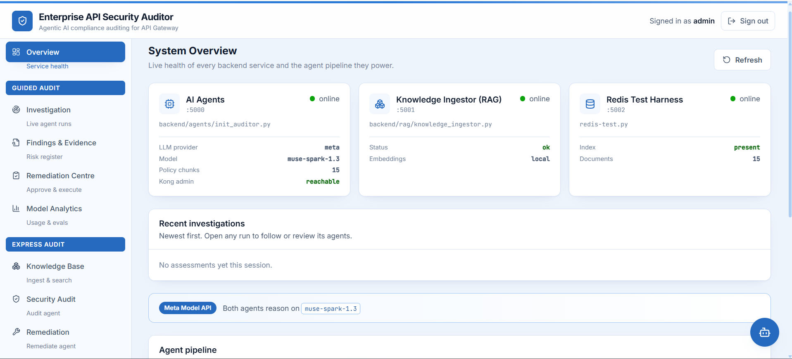
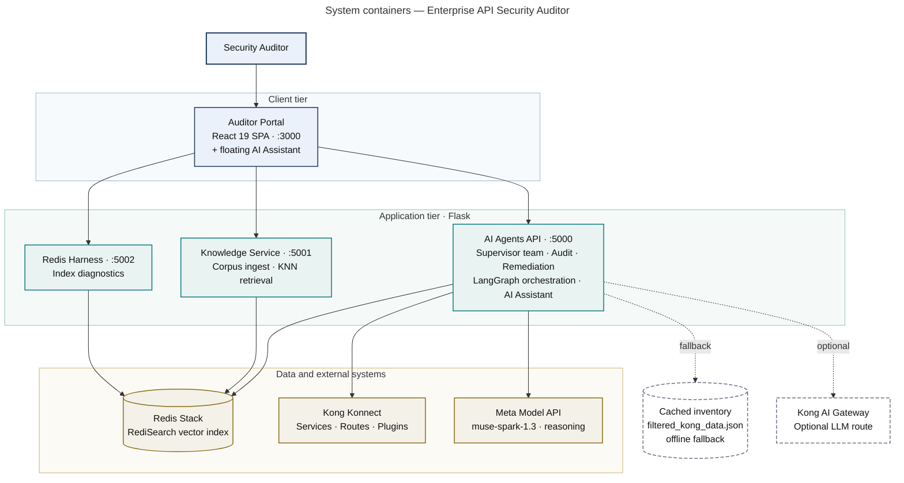
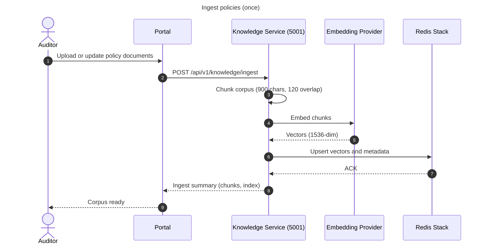
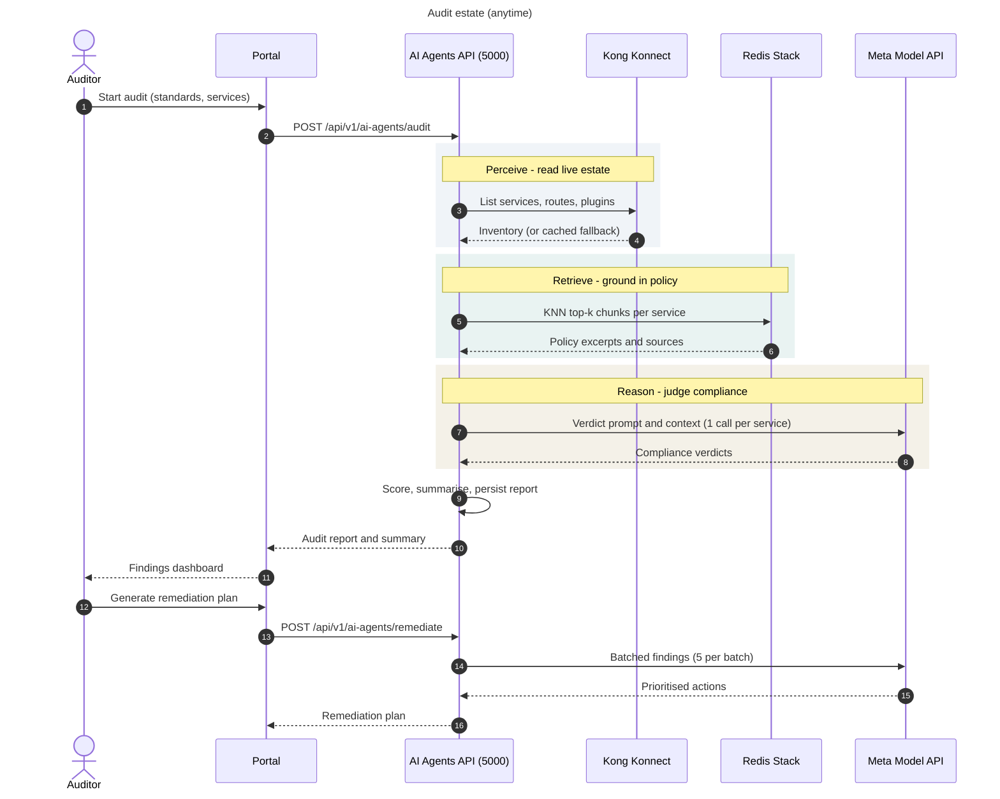
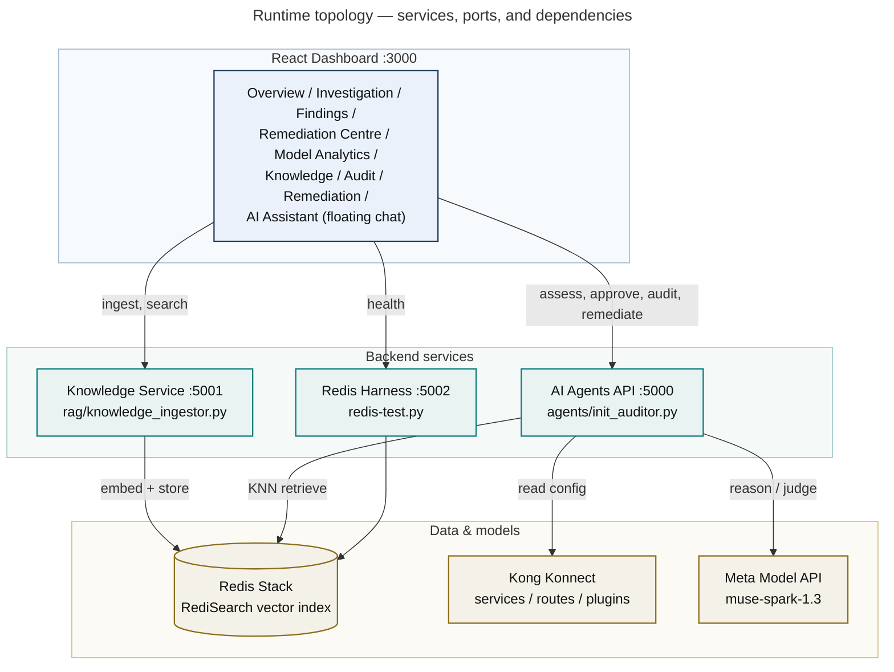
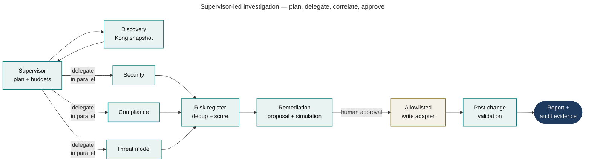

# Enterprise API Security Auditor

Enterprise API Security Auditor is an autonomous security auditor agentic AI application that helps to audit your API and AI gateways. Ingest your security policies once. Audit your entire API estate anytime, automatically,
against GDPR, HIPAA, PCI-DSS, ISO 27001, OWASP API Top 10, PSD2/SCA, NIST and SOC 2, etc.
**without anyone on the team needing to know those standards**.

---



## Table of Contents

1. [The problem](#the-problem)
2. [The solution](#the-solution)
3. [Why this matters](#why-this-matters)
4. [Meta models in this project](#meta-models-in-this-project)
5. [Architecture](#architecture)
6. [Repository layout](#repository-layout)
7. [Prerequisites (Windows)](#prerequisites-windows)
8. [Installation (Windows)](#installation-windows)
9. [Configuration](#configuration)
10. [Running the stack](#running-the-stack)
11. [API catalog](#api-catalog)
12. [Postman collection](#postman-collection)
13. [Frontend](#frontend)
14. [AI Assistant](#ai-assistant)
15. [Tests](#tests)
16. [Troubleshooting](#troubleshooting)
17. [Documentation](#documentation)
18. [Technology stack](#technology-stack)
19. [Author](#author)

---

## The problem

**How API security compliance works today — and why it fails.**

Every enterprise has a shelf of security policies: authentication standards, rate-limiting
rules, data-privacy requirements, logging mandates. Every enterprise also has hundreds of
APIs on a gateway. Connecting the two is **entirely manual**:

| Today | Consequence |
|---|---|
| A human reads the policy documents | Takes days; policies are long and change often |
| A human opens each API config and compares it by hand | Error-prone; nobody checks all of them |
| The reviewer must *personally know* GDPR, OWASP, ISO 27001, PCI-DSS… | A scarce, expensive skill — and a single point of failure |
| Findings land in a spreadsheet checklist | Stale the moment a config changes |
| Fixes are figured out from scratch each time | Inconsistent remediation, no standard citations |

**What existed before this project:** manual security reviews, hand-maintained validation
checklists, and tribal knowledge. There was **no agentic system** that could read an
organization's own policies and autonomously judge a live API estate against them.

The result is predictable — security gaps ship to production, audits are reactive, and
compliance depends on whether one expert happened to be in the room.

---

## The solution

**Enterprise API Security Auditor — an agentic AI application.**

A supervisor-led team of nine LangGraph agents replaces the manual loop end
to end (the original two single-agent paths are kept and still work):

```
Ingest policies ONCE  →  Investigate ANYTIME  →  Approve  →  Remediate safely  →  Ask the copilot
```

### How it works

1. **Ingest once.** Drop versioned policy documents into `backend/knowledge_base/`.
   They are chunked, embedded and stored in Redis; re-ingest re-indexes only what
   changed — no code changes, no retraining.
2. **Investigate anytime.** A supervisor plans the run, discovery pulls Kong
   inventory, and security / compliance / threat agents investigate in parallel.
   **Meta's Muse Spark 1.3** reasons over retrieved policy excerpts; deterministic
   code verifies every claim, scores one deduplicated risk register, and pauses
   for human approval.
3. **Remediate safely.** Structured change proposals carry diffs, simulations and
   residual risk. Approved changes execute through an allowlisted adapter with
   post-change validation; everything lands in a hash-chained audit log.
4. **Ask the copilot.** A floating AI Assistant on every dashboard page
   answers security questions, explains findings with evidence, runs
   supervised tasks and drafts fixes — approvals and execution stay
   human-gated.

### What it replaces

| Before | After |
|---|---|
| Days of manual review | **~57 seconds** for 8 services, 20 policy checks |
| Expert must know every standard | Agent reads your policies; **no standards expertise needed** |
| Static checklist, instantly stale | Re-run on demand; always reflects live config |
| "Something is wrong" | "`jwt` and `oauth2` are missing on `PaymentService`, Critical, ~4h, OWASP API2:2023" |
| Remediation invented each time | Consistent, standard-referenced plan |

### Supported standards

GDPR · HIPAA · PCI-DSS · ISO 27001 · OWASP API Top 10 · PSD2/SCA · PIPEDA · NIST · SOC 2

These aren't hardcoded. The agent evaluates against **whatever policies you ingest**, so
adding a new standard means adding a document — not shipping code.

---

## Why this matters

**Easy to use, but it closes a critical enterprise gap.**

The hard part of API security compliance was never running a scanner — it was **knowing
what to look for**. This project removes that requirement. A developer who has never read
GDPR can run a GDPR audit of their API and get an actionable, cited fix plan in under a
minute.

- **Impact** — turns a multi-day expert task into a one-click operation, and makes
  continuous auditing possible instead of annual
- **Accessible** — ingest policies, press a button; no security certification required
- **Grounded, not guessed** — every verdict reports `policy_sources`, naming the policy
  files that justified it, so findings are auditable rather than opaque
- **Honest** — when a dependency is degraded the API says so explicitly instead of
  silently returning a worse answer

---

## Meta models in this project

This project runs on the **[Meta Model API](https://developer.meta.com/ai/resources/blog/build-with-muse-spark/)**.

| Model | Where it is used |
|---|---|
| **`muse-spark-1.3`** | The reasoning engine for **all nine reasoning tasks** — six investigation tasks plus three assistant tasks (intent, Q&A, synthesis) — investigation, evidence correlation, threat modelling, risk explanation, remediation planning and executive summaries — via one enforced routing table (`GET /llm/policy`). See [Why Muse Spark](docs/why-muse-spark.md) |
| **Muse Code** | Used as the coding agent while developing this project |
| **Muse Spark Open** | Same lineage; the pipeline can target a self-hosted instance via `META_BASE_URL` |

**Why Muse Spark fits this use case.** Both agents depend on *strict structured
output* — the Audit Agent must return a precise JSON verdict object per service, and the
Remediation Agent a JSON array with ten required fields per item. Muse Spark 1.3 is a
strong instruction-following reasoning model served through an OpenAI-compatible endpoint,
which is exactly the shape this workload needs.

**On model availability.** `GET https://api.meta.ai/v1/models` reports what a key can
use. For this project's key that is `muse-spark-1.3`, `muse-spark-1.3-contributor`,
`muse-spark-1.2(-contributor)`, `muse-spark-1.1`, plus `muse-wonder-1.0`,
`muse-image-1.0`, `muse-voice-transcribe-1.0` and `sam-3.1`.

`muse-spark-open` is **not** served by the Model API - it is an open-weights model
meant to be self-hosted, so requesting `meta-models/muse-spark-open-1026` returns
`model_not_found`. The hackathon brief covers both routes: the Muse Spark series via
Meta Model API (used here), and Muse Spark Open / Muse Glimmer as open weights. Because
Muse Spark Open shares the Muse Spark lineage, this pipeline can be pointed at a
self-hosted instance later by changing `META_BASE_URL` and `META_MODEL` alone.

### How it is wired

Meta Model API exposes an OpenAI-compatible `/chat/completions` surface, so the standard
`openai` SDK is pointed at it:

```python
# backend/common/llm.py
from openai import OpenAI

client = OpenAI(
    base_url="https://api.meta.ai/v1",     # META_BASE_URL
    api_key=config.META_API_KEY,           # META_API_KEY
)

response = client.chat.completions.create(
    model="muse-spark-1.3",   # META_MODEL
    messages=messages,
    max_tokens=config.LLM_MAX_TOKENS,
)
```

All LLM access funnels through a central router (`backend/common/router.py`) over
transports in `backend/common/llm.py`, so the provider is a single configuration
switch (`meta` | `kong`) rather than something scattered across the
agents. No agent picks its own model, and an empty model id refuses to call.

### Setup — one value to change

```ini
# backend/.env
META_API_KEY = <paste the key from the Meta Model API console>
META_MODEL   = muse-spark-1.3
META_BASE_URL = https://api.meta.ai/v1
LLM_PROVIDER = meta
```

Then verify in one command:

```powershell
python backend\scripts\verify_meta.py
```

It checks configuration, network reachability, a live chat completion, and a real
structured-audit response — and tells you precisely which step failed.

> **Note on embeddings.** Meta Model API does not currently expose an embeddings
> endpoint, so the RAG *retrieval* layer uses locally produced vectors. All
> **reasoning** — every compliance verdict and every remediation action — runs
> on Muse Spark.

---

## Architecture

### System containers




### Ingest and audit sequences

Ingestion and auditing are separate flows — ingest the corpus once, audit the estate anytime.





### Runtime topology



### Agent pipeline



The nine logical agents run this **plan → investigate → evaluate → decide** loop
under supervisor control (`backend/agents/orchestrator.py`): independent
investigations run in parallel, evidence fans in to one scored risk register,
and the workflow pauses for human approval before anything is executed. See
[multi-agent architecture](docs/multi-agent-architecture.md) for the full
diagram, budgets and resume semantics.

The **Retrieve** stage is what makes this RAG rather than a bare prompt: each
finding becomes a query, the matching policy excerpts are pulled from Redis, and
only those excerpts are given to the model. Every verdict reports the chunk IDs
and files that grounded it.

(The original `/audit` + `/remediate` single-agent path is kept and bypasses
the orchestrator — same inputs, same shapes, for existing clients.)

---

## Repository layout

```
enterprise-api-security-auditor-agents/
├── enterprise-api-security-auditor-agents.postman_collection.json   # 24 requests, 6 folders
├── README.md
├── redis-test.py                        # :5002  standalone Redis harness
├── start_all.py                         # one-command launcher: harness → knowledge → agents → dashboard
├── backend/
│   ├── .env                             # all configuration lives here
│   ├── requirements.txt
│   ├── docker-compose.yaml              # Redis Stack
│   ├── common/                          # shared layer
│   │   ├── config.py                    #   env loading + effective config
│   │   ├── auth.py                      #   API-key auth, viewer/operator/admin
│   │   ├── validation.py                #   payload validation, prompt sanitising
│   │   ├── audit_log.py                 #   hash-chained audit log
│   │   ├── embeddings.py                #   offline embedding provider
│   │   ├── llm.py                       #   Meta | Kong AI Gateway route
│   │   ├── router.py                    #   central model router + call log
│   │   ├── rules.py                     #   deterministic verdict verification
│   │   ├── policy.py                    #   versioned control catalog
│   │   ├── threats.py                   #   threat-scenario engine
│   │   ├── risks.py                     #   risk register + versioned scoring
│   │   ├── changes.py                   #   change proposals + simulator input
│   │   ├── kong_adapter.py              #   allowlisted Kong write adapter
│   │   ├── kong_inventory.py            #   resilient discovery + snapshots
│   │   ├── conversations.py             #   assistant chat history (Redis)
│   │   └── vector_store.py              #   Redis index, upsert, curated KNN
│   ├── scripts/verify_meta.py           #   one-command Meta Model API check
│   ├── eval/                            #   model + retrieval eval suites
│   ├── rag/knowledge_ingestor.py        # :5001  ingest + retrieval API
│   ├── agents/
│   │   ├── orchestrator.py              #   supervisor-led 9-agent LangGraph
│   │   ├── assistant.py                 #   conversational copilot graph (chat + tools)
│   │   ├── schemas.py / tools.py        #   typed state, tool gateway
│   │   ├── auditor_agent.py             #   legacy single-agent graphs
│   │   ├── init_auditor.py              # :5000  agent HTTP API
│   │   └── filtered_kong_data.json      #   cached inventory (offline fallback)
│   ├── knowledge_base/                  # versioned policy corpus
│   ├── artifacts/                       # generated reports, snapshots, audit log
│   └── tests/                           # pytest suite, fully offline
├── docs/                                # architecture, API, setup, eval + demo guides
└── frontend/                            # :3000  React + Tailwind dashboard
    └── src/
        ├── api/client.js                #   every backend call goes through here
        ├── components/                  #   Header, Sidebar, Login, chat cards, ui primitives
        └── pages/                       #   Investigation, Findings, Remediation
                                         #   Centre, Model Analytics, Assistant (chat) + originals
```

---

## Prerequisites (Windows)

| Requirement | Version | Notes |
|---|---|---|
| **Python** | 3.11+ | Tested on 3.14. `py --version` |
| **Node.js** | 18+ | `node --version` |
| **Docker Desktop** | latest | Only if running Redis locally |
| **Redis Stack** | 7+ | **Must include the RediSearch module** |
| **Meta Model API key** | — | **Required.** From the Meta Model API console |
| **Kong Konnect** _or_ **Kong Gateway** | — / 3.x | Optional — the audit falls back to a cached inventory |

> **Plain `redis` will not work.** Vector search needs the RediSearch module, which
> ships in `redis/redis-stack-server`. Verify with `GET /api/v1/knowledge/health` — it
> reports `search_module: true` when correct.

---

## Installation (Windows)

All commands are PowerShell, run from the repository root.

### 1. Clone and enter the project

```powershell
cd C:\Users\<you>\projects
git clone <repo-url> enterprise-api-security-auditor-agents
cd enterprise-api-security-auditor-agents
```

### 2. Start Redis Stack

**Option A — Docker (recommended)**

```powershell
docker compose -f backend\docker-compose.yaml up -d
docker ps   # confirm the `redis` container is running
```

**Option B — remote/managed Redis**
Skip Docker and point `REDIS_HOST` / `REDIS_PORT` in `backend\.env` at your instance.

Verify the module is present:

```powershell
docker exec -it redis redis-cli MODULE LIST
# expect an entry with name "search"
```

### 3. Create the Python virtual environment

```powershell
cd backend
python -m venv .venv
.\.venv\Scripts\Activate.ps1
python -m pip install --upgrade pip
python -m pip install -r requirements.txt
```

> If PowerShell blocks activation:
> `Set-ExecutionPolicy -Scope Process -ExecutionPolicy Bypass`

### 4. Configure `backend\.env`

See [Configuration](#configuration) below. At minimum set **`META_API_KEY`** and
`REDIS_HOST`. Then confirm with `python backend\scripts\verify_meta.py`.

### 5. Install frontend dependencies

```powershell
cd frontend
npm install
cd ..
```

---

## Configuration

Everything is read from **`backend\.env`**. It is loaded by absolute path, so services
work no matter which directory you launch them from.

### Redis

| Variable | Default | Purpose |
|---|---|---|
| `REDIS_HOST` | `localhost` | Redis Stack hostname |
| `REDIS_PORT` | `6379` | Redis port |
| `REDIS_PASSWORD` | _(none)_ | Optional auth |
| `REDIS_USERNAME` | _(none)_ | Redis ACL username (use least-privilege) |
| `INDEX_NAME` | `security_auditor_index` | RediSearch index name |
| `KEY_PREFIX` | `embedding:` | Key prefix the index covers |
| `VECTOR_DIMENSIONS` | `1536` | **Must match the embedding model** |

### API auth (both Flask apps)

| Variable | Default | Purpose |
|---|---|---|
| `ADMIN_API_KEYS` | _(none)_ | Full access: ingest, deletes, live execution |
| `OPERATOR_API_KEYS` | _(none)_ | Run/resume assessments, approve, simulate |
| `VIEWER_API_KEYS` | _(none)_ | Read-only |
| `ALLOWED_ORIGINS` | _(none)_ | CORS allowlist; unset means `*` |

Comma-separated lists. No keys anywhere = single-user mode (open). Dashboard
sign-in verifies the key against the backend; keys live in sessionStorage.

### Knowledge base

| Variable | Default | Purpose |
|---|---|---|
| `KNOWLEDGE_BASE_DIR` | `knowledge_base` | Policy corpus, relative to `backend/` |
| `CHUNK_SIZE` | `900` | Characters per chunk |
| `CHUNK_OVERLAP` | `120` | Overlap between chunks |

### Meta Model API (primary LLM)

| Variable | Default | Purpose |
|---|---|---|
| `META_API_KEY` | _(none)_ | **Required.** Key from the Meta Model API console |
| `META_MODEL` | `muse-spark-1.3` | Latest Muse Spark on the Model API |
| `META_BASE_URL` | `https://api.meta.ai/v1` | OpenAI-compatible endpoint |

Verify with `python backend\scripts\verify_meta.py`.


### Provider selection

| Variable | Values | Behaviour |
|---|---|---|
| `LLM_PROVIDER` | `meta` \| `kong` \| `auto` | `meta` is the hackathon target; `auto` prefers Meta when `META_API_KEY` is set, else Kong |

> **About embeddings.** Retrieval vectors are deterministic hashed bag-of-words,
> so the RAG pipeline runs fully offline. But they are **lexical**: they match
> shared vocabulary, *not* paraphrase. Keyword queries rank correctly;
> semantically-worded questions will not.

### Kong

Both **Kong Konnect** (SaaS control plane) and a **self-managed Admin API** are
supported. They differ in three ways, all handled automatically:

| | Kong Konnect | Self-managed |
|---|---|---|
| Auth header | `Authorization: Bearer kpat_...` | `kong-admin-token: <token>` |
| Entity path | `/core-entities/services` | `/services` |
| TLS | valid public cert → verify **on** | usually self-signed → verify **off** |

Sending a Konnect PAT as `kong-admin-token` returns **401**; requesting a bare
`/services` on a control plane returns **404**.

| Variable | Purpose |
|---|---|
| `KONG_ADMIN_API` | Admin API base URL (trailing slash stripped automatically) |
| `KONG_ADMIN_TOKEN` | Konnect PAT (`kpat_...`) or self-managed admin token |
| `KONG_ADMIN_MODE` | `auto` \| `konnect` \| `onprem` — `auto` detects Konnect from the hostname |
| `KONG_ADMIN_VERIFY_SSL` | Defaults to `true` for Konnect, `false` for self-managed |
| `KONG_PAGE_SIZE` | Page size when listing entities (default `1000`) |
| `KONG_HTTP_TIMEOUT` | Per-request timeout in seconds (default `30`) |
| `KONG_MAX_RETRIES` / `KONG_RETRY_BACKOFF_S` / `KONG_RETRY_MAX_WAIT_S` | Transient retries: 429 honours Retry-After within the cap (defaults `2` / `1` / `5`) |
| `KONG_SNAPSHOT_KEY` / `KONG_SNAPSHOT_STALE_S` | Redis snapshot cache + staleness horizon (defaults `kong:snapshot:latest` / `3600`) |
| `KONG_WRITE_ENABLED` | Live remediation writes; default `false` (simulation only) |
| `KONG_AI_PROXY_HOSTNAME` | Optional — Kong AI Gateway base URL |
| `KONG_API_KEY` | Optional — `x-api-key` for the AI Gateway |

**Konnect setup**

1. In Konnect, go to **Personal Access Tokens** and create a PAT (`kpat_...`).
2. Copy the **control plane ID** from the control-plane URL.
3. Set, using your geo (`eu`, `us`, `au`, `in`, `me`):

```ini
KONG_ADMIN_API = https://eu.api.konghq.com/v2/control-planes/<control-plane-id>
KONG_ADMIN_TOKEN = kpat_xxxxxxxx
KONG_ADMIN_MODE = auto
```

Confirm with `GET /api/v1/ai-agents/health` → `dependencies.kong_mode: "konnect"`
and a non-zero `dependencies.kong_services`.

> **Effective plugin set.** The inventory fetches services, routes and plugins
> once each and joins them in memory — 3 requests regardless of estate size,
> rather than `1 + 2N`. `service_plugins` combines plugins bound to the service,
> plugins bound to **any of its routes**, and gateway-wide plugins. Most Konnect
> estates bind plugins at the route level, so without the route rollup nearly
> every service would look unprotected.

### TLS behind a corporate proxy

Corporate TLS-inspection proxies re-sign traffic with an internal root CA that
Windows trusts but `certifi` (which `requests` uses) does not. The symptom is an
`SSLError` from the app against a URL that `curl` reaches fine.

`backend/requirements.txt` includes **`truststore`**, which makes Python use the
OS certificate store, so verification stays **enabled**. Check it is active:

```
GET /api/v1/ai-agents/health  →  config.tls.system_trust_store: true
```

Last resort only: `KONG_ADMIN_VERIFY_SSL = false`.

### LLM limits & routing

| Variable | Default | Purpose |
|---|---|---|
| `LLM_MAX_TOKENS` | `8000` | Output cap per call. Reasoning models count reasoning tokens against this. |
| `LLM_TIMEOUT` | `120` | Per-call timeout, seconds |
| `ROUTER_MAX_RETRIES` | `2` | Bounded retries (retryable errors only) |
| `CIRCUIT_THRESHOLD` / `CIRCUIT_COOLDOWN_S` | `5` / `60` | Circuit breaker |
| `META_ONLY` | `true` | Forbid non-Meta reasoning providers |
| `LLM_FALLBACK_ORDER` | `none` | Opt-in fallback chain (observable, never silent) |
| `REMEDIATION_BATCH_SIZE` | `5` | Findings per remediation call |

> Remediation is **batched** on purpose. One call for all findings grows with the
> estate and silently truncates once the response passes the cap — yielding
> invalid JSON and losing the entire plan. With 16 findings the response landed at
> ~3,900–4,100 tokens against the old 4,000 cap, so it parsed intermittently.
> Batching bounds every response; a batch that still fails is retried one finding
> at a time so a single bad response cannot discard the group.

### Ports

| Variable | Default | Service |
|---|---|---|
| `AGENTS_PORT` | `5000` | AI Agents API |
| `KNOWLEDGE_PORT` | `5001` | Knowledge Ingestor |

(The Redis harness listens on a fixed `5002`.)

---

## Running the stack

One command starts everything in order (repo root, venv activated):

```powershell
backend\.venv\Scripts\Activate.ps1
python start_all.py
# Options: --skip-redis-test, --skip-frontend, --timeout 90
```

Each Python service starts only after the previous one answers its health
endpoint; services already running are detected and skipped. On Windows every
service opens in its own console window.

Or run each service in its **own** PowerShell window, with the venv activated.

```powershell
# Terminal 1 - Redis Test Harness  (:5002)
backend\.venv\Scripts\Activate.ps1
python redis-test.py

# Terminal 2 - Knowledge Ingestor  (:5001)
backend\.venv\Scripts\Activate.ps1
python backend\rag\knowledge_ingestor.py

# Terminal 3 - AI Agents API  (:5000)
backend\.venv\Scripts\Activate.ps1
python backend\agents\init_auditor.py

# Terminal 4 - React dashboard  (:3000)
cd frontend
npm start
```

Each service prints its effective configuration on startup.

### First-run order

```powershell
# 1. Confirm everything is wired up
curl http://localhost:5001/api/v1/knowledge/health
curl http://localhost:5000/api/v1/ai-agents/health

# 2. Ingest the policy corpus into Redis
curl -X POST http://localhost:5001/api/v1/knowledge/ingest `
     -H "Content-Type: application/json" -d '{\"reset\": true}'

# 3. Prove retrieval works
curl -X POST http://localhost:5001/api/v1/knowledge/search `
     -H "Content-Type: application/json" `
     -d '{\"query\": \"Which plugin enforces authentication?\", \"top_k\": 3}'

# 4a. Run a supervisor-led investigation (multi-agent path)
curl -X POST http://localhost:5000/api/v1/ai-agents/assess `
     -H "Content-Type: application/json" `
     -d '{\"selected_standards\": [\"OWASP API Top 10\", \"GDPR\"]}'

# 4b. Poll the event trace, then approve a proposed change
curl http://localhost:5000/api/v1/ai-agents/assess/<id>
curl -X POST http://localhost:5000/api/v1/ai-agents/assess/<id>/changes/<change_id>/approve `
     -H "Content-Type: application/json" -d '{}'

# 4c. Legacy single-agent path (still supported)
curl -X POST http://localhost:5000/api/v1/ai-agents/audit `
     -H "Content-Type: application/json" `
     -d '{\"selected_standards\": [\"OWASP API Top 10\", \"GDPR\"]}'

curl -X POST http://localhost:5000/api/v1/ai-agents/remediate `
     -H "Content-Type: application/json" -d '{}'
```

(With API keys configured, add `-H "X-API-Key: <key>"` to every call.)

> PowerShell's `curl` is an alias for `Invoke-WebRequest` and quotes JSON differently.
> For anything non-trivial, use the Postman collection or `curl.exe` explicitly.

---

## API catalog

### AI Agents — `http://localhost:5000`

| Method | Path | Description |
|---|---|---|
| `GET` | `/api/v1/ai-agents/health` | LLM provider, Redis state, policy chunk count, Kong reachability |
| `GET` | `/api/v1/ai-agents/models` | Model ids the key can use; resolves `model_not_found` |
| `GET` | `/api/v1/ai-agents/kong/services` | Inventory to be audited, with `source` provenance |
| `POST` | `/api/v1/ai-agents/audit` | Run the Audit Agent (legacy, still supported) |
| `POST` | `/api/v1/ai-agents/remediate` | Run the Remediation Agent (legacy, still supported) |
| `GET` | `/api/v1/ai-agents/audit/report` | Replay the last audit report |
| `GET` | `/api/v1/ai-agents/remediate/plan` | Replay the last remediation plan |
| `POST` | `/api/v1/ai-agents/assess` | Start a supervisor-led investigation (`?async=true` to poll) |
| `GET` | `/api/v1/ai-agents/assess/<id>` | Event trace + status for an investigation |
| `GET` | `/api/v1/ai-agents/assess/<id>/details` | Full findings, evidence, risk register |
| `POST` | `/api/v1/ai-agents/assess/<id>/resume` | Resume a paused/failed investigation |
| `POST` | `/api/v1/ai-agents/assess/<id>/executive-summary` | Muse-written executive summary |
| `GET` | `/api/v1/ai-agents/llm/calls` | Per-call model trace (name, task, latency) |
| `GET` | `/api/v1/ai-agents/llm/policy` | Effective routing table |
| `GET`/`POST` | `/api/v1/ai-agents/assess/<id>/changes…` | Proposals, simulate, approve, execute |

Full request/response shapes: [API reference](docs/api.md).

<details>
<summary><strong>POST /api/v1/ai-agents/audit</strong></summary>

**Request** — every field optional:
```json
{
  "selected_standards": ["OWASP API Top 10", "GDPR", "NIST"],
  "service_names": ["Healthcheck", "orders-api"],
  "top_k": 4,
  "kong_data": [
    { "service_name": "PaymentService", "service_id": "x", "service_plugins": ["key-auth"] }
  ]
}
```
- `service_names` — audit only these services (case-insensitive). Cost is one LLM call
  per service, so this is the fast path while iterating.
- `kong_data` — bypasses the Kong Admin API entirely; useful for demos and for testing
  specific plugin combinations.

**Response**
```json
{
  "audit_report": {
    "HealthService:policy:HealthService": {
      "serviceName": "HealthService",
      "service_plugins": ["key-auth", "request-transformer"],
      "policy_sources": ["01_authentication_policy.txt"],
      "policies": [
        {
          "policy_name": "Authentication Policy v1.0",
          "comply": false,
          "missing_plugins": ["jwt", "oauth2"],
          "details": "..."
        }
      ]
    }
  },
  "summary": {
    "services_audited": 2, "policies_evaluated": 3,
    "compliant": 1, "non_compliant": 2, "compliance_rate": 33.3,
    "retrieved_policy_chunks": 8, "llm_provider": "local"
  },
  "kong_source": "kong_konnect",
  "warnings": []
}
```
Takes ~30–60s: one LLM call per service. Measured against a Konnect control plane
with 8 services: **57s**, 20 policies evaluated. `kong_source` is one of
`kong_konnect`, `kong_onprem`, `request` or `cached_file`.
</details>

<details>
<summary><strong>POST /api/v1/ai-agents/remediate</strong></summary>

**Request** — `{}` falls back to the last saved audit report:
```json
{ "audit_report": { "...": "output of the audit endpoint" } }
```

**Response** — a severity-sorted array (Critical first):
```json
[
  {
    "serviceName": "HealthService",
    "policyName": "Authentication Policy v1.0",
    "issue": "...",
    "missingPlugin": "jwt, oauth2",
    "recommendedAction": "...",
    "severity": "Critical",
    "owner": "API Gateway Team",
    "estimatedEffort": "4 hours",
    "impact": "...",
    "securityStandardReference": "OWASP API2:2023 Broken Authentication"
  }
]
```
Add `?envelope=true` to get `{remediation_plan, summary, findings_count, note, error}`
instead of the bare array.
</details>

### AI Assistant (chat API) — same `http://localhost:5000`

| Method | Path | Description |
|---|---|---|
| `GET` | `/api/v1/ai-agents/assistant/prompts` | Suggested starter prompts |
| `POST` | `/api/v1/ai-agents/assistant/conversations` | Start a chat (201) |
| `GET` | `/api/v1/ai-agents/assistant/conversations` | Own chat history, newest first |
| `GET` | `/api/v1/ai-agents/assistant/conversations/<id>` | Thread + supervised tasks |
| `DELETE` | `/api/v1/ai-agents/assistant/conversations/<id>` | Delete own thread |
| `POST` | `/api/v1/ai-agents/assistant/conversations/<id>/messages` | Send a message, get a reply |
| `POST` | `.../messages/stream` | Same, streamed (header → deltas → done) |
| `GET` | `/api/v1/ai-agents/assistant/tasks/<task_id>` | Supervised task status |

Chats are isolated per API key. The assistant can read and draft, never
approve or execute — no such tool exists in its allowlist.

### Knowledge Ingestor / RAG — `http://localhost:5001`

| Method | Path | Description |
|---|---|---|
| `GET` | `/api/v1/knowledge/health` | Embedding config, Redis + RediSearch, corpus directory |
| `POST` | `/api/v1/knowledge/index` | Create the vector index (`{"recreate": true}` to rebuild) |
| `POST` | `/api/v1/knowledge/ingest` | Chunk, embed and store the corpus (`{"reset": true}`) |
| `POST` | `/api/v1/knowledge/search` | **KNN retrieval** — `{"query": "...", "top_k": 5}` |
| `GET` | `/api/v1/knowledge/get_all_embeddings` | Inventory — `?limit=50&include_vector=false` |
| `GET` | `/api/v1/knowledge/stats` | Index name, doc count, dimensions, module presence |
| `DELETE` | `/api/v1/knowledge/embeddings` | Clear the corpus (index definition is kept) |

<details>
<summary><strong>POST /api/v1/knowledge/search</strong> — the request that proves RAG</summary>

```json
{ "query": "Which plugin enforces authentication on a Kong service?", "top_k": 3 }
```
```json
{
  "query": "...", "count": 3, "embedding_provider": "local",
  "results": [
    {
      "id": "embedding:331739f3-...",
      "source": "01_authentication_policy.txt",
      "score": 0.2343,
      "content": "Policy Name: Authentication Policy v1.0 ...",
      "metadata": { "chunk_index": 0, "chunk_count": 1 }
    }
  ]
}
```
`score` is cosine **similarity** (higher is better), converted from RediSearch's distance.
</details>

### Redis Test Harness — `http://localhost:5002`

| Method | Path | Description |
|---|---|---|
| `GET` | `/redis/index_info` | Host, port, loaded `.env`, index presence, doc count |
| `POST` | `/redis/create_index` | Create index — `index_name`, `prefix`, `vector_dimensions`, `recreate` |
| `POST` | `/redis/add_embedding` | Store a text/JSON pair (connectivity check, **not** a real vector) |
| `GET` | `/redis/all_embeddings` | List every `embedding:*` key — `?limit=10&include_vector=false` |
| `DELETE` | `/redis/all_embeddings` | Delete every `embedding:*` key |

> `add_embedding` writes a JSON blob, not a FLOAT32 vector, so documents created there are
> **not** returned by KNN search, yet they still count toward `num_docs`. Use the
> ingestion API for real vectors. In the listing, `vector_dimensions: 0` marks a
> document that has no usable vector.

---

## Postman collection

Import **`enterprise-api-security-auditor-agents.postman_collection.json`** from the repo root
— 24 requests across 6 folders.

| Folder | Contents |
|---|---|
| `00 - Health Checks` | All three services |
| `01 - Redis Test Harness (5002)` | Index + embedding CRUD |
| `02 - Knowledge Ingestion / RAG (5001)` | Create index → ingest → search → stats |
| `03 - AI Agent: Audit (5000)` | Inventory, audit (live / offline / scoped), replay |
| `04 - AI Agent: Remediate (5000)` | Plan generation and replay |
| `05 - Meta Model API (direct)` | List models, chat completion, structured audit prompt — direct probes, no backend |

Collection variables (`agents_url`, `knowledge_url`, `redis_test_url`) default to
localhost. **Run Security Audit** stores its report in the `audit_report` variable, so
**Generate Remediation Plan** works with no copy/paste.

> The collection covers the health, RAG and legacy single-agent endpoints. The
> multi-agent `assess` / `changes` routes are documented in
> [docs/api.md](docs/api.md) and are not in the collection yet.

---

## Frontend

```powershell
cd frontend
npm install
npm start          # http://localhost:3000
npm run build      # production bundle
```

Sign-in uses demo usernames (**admin** / **operator** / **viewer**) with passwords
from `frontend/.env`, shown on the login page itself. Each account maps to that
role's API key, so the backend still enforces roles; keys are kept in
sessionStorage and cleared on sign-out.

| Page | What it does |
|---|---|
| **Overview** | Live health of all three services, agent pipeline, quick-start actions |
| **Investigation** | Live multi-agent runs: plan, agent activity, model used, approvals |
| **Findings & Evidence** | Risk register with evidence, controls and verification status |
| **Remediation Centre** | Proposals with diffs + simulation, approve, execute, validate |
| **Model Analytics** | Model usage, routing policy, retrieval-eval figures |
| **Knowledge Base** | Ingest the corpus, run vector searches, browse stored chunks |
| **Security Audit** | Legacy single-agent audit: standards, inventory, export JSON |
| **Remediation** | Legacy single-agent plan: severity breakdown, export JSON |
| **AI Assistant** (floating) | Chat copilot on every page: asks, explains, runs tasks, drafts fixes |

Endpoints default to localhost and can optionally be overridden in **`frontend\.env`**:

```
REACT_APP_AGENTS_URL=http://localhost:5000
REACT_APP_KNOWLEDGE_URL=http://localhost:5001
REACT_APP_REDIS_TEST_URL=http://localhost:5002
REACT_APP_ADMIN_PASSWORD=Admin@123
REACT_APP_OPERATOR_PASSWORD=Operator@123
REACT_APP_VIEWER_PASSWORD=Viewer@123
REACT_APP_ADMIN_KEY=<must match backend ADMIN_API_KEYS>
REACT_APP_OPERATOR_KEY=<must match backend OPERATOR_API_KEYS>
REACT_APP_VIEWER_KEY=<must match backend VIEWER_API_KEYS>
```

Copy `frontend/.env.example` to `frontend/.env` (gitignored) and paste the keys.
After changing it, restart `npm start` - Create React App reads `.env` at startup.

---

## AI Assistant

Click the round button at the bottom-right of any dashboard page to open the
**AI Security Assistant** — a conversational copilot over the whole system,
powered by Muse Spark 1.3. In plain words:

- **Ask anything** — "Which APIs are missing authentication?", "Why is SvcB
  non-compliant?", "Explain this finding."
- **Run supervised tasks** — "Audit all APIs and flag critical issues."
  Long work runs through the real agent workflows, with live progress shown
  in the chat.
- **Draft fixes** — "Prepare remediation proposals for the critical
  findings." Proposals link into the approval workflow; nothing is approved
  or executed from chat, ever.
- **Trust what you see** — every reply is labelled **Verified findings**
  (tool output with evidence) or **AI-generated** (model wording), so the two
  can never be confused.

Chatting is isolated per signed-in user, and injection attempts are refused
with an explanation. Full design, intents, tools and demo scenarios:
[AI Assistant](docs/assistant.md).

---

## Tests

```powershell
backend\.venv\Scripts\Activate.ps1
python -m pytest backend\tests -q
```

379 backend tests covering every agent node, both legacy graphs, the supervisor-led
orchestrator (parallelism, failure, resume, approval), the policy / threat / risk /
remediation engines, Konnect vs self-managed auth and entity paths, pagination, the
route-plugin rollup, remediation batching and its per-finding retry, severity mapping,
JSON-parsing failure paths, the Kong fallback and snapshots, deterministic RAG ingestion
and retrieval, API-key auth and the hash-chained audit log, and the **Meta Model API
provider** (resolution, model id, parameter fallbacks, fenced-JSON parsing, and a full
audit-graph run on Meta, the assistant chat graph/API, and the `start_all.py`
launcher). The LLM, Kong and Redis are all stubbed, so the suite runs
offline with no credentials. The frontend adds 26 tests across 7 suites (app
shell, login, assistant chat + widget, API client, UI guards)
(`npm test -- --watchAll=false` from `frontend/`).

```powershell
python backend\eval\run_retrieval_eval.py --store fake   # 10 tasks; hit_rate 1.0, MRR 0.95
python backend\eval\run_eval.py --compare mock:good mock:weak   # judge check, 6 mock tasks
```

Full figures and what was *not* verified live: [test report](docs/test-report.md).

---

## Troubleshooting

| Symptom | Cause & fix |
|---|---|
| `model_not_found` from Meta | The key is valid and the request reached Meta - only `META_MODEL` is wrong. Run `GET /api/v1/ai-agents/models` (or `curl -H 'Authorization: Bearer <KEY>' https://api.meta.ai/v1/models`) and set `META_MODEL` to a listed id. Note `muse-spark-open` is open-weights only, not on the API. |
| `META_API_KEY is not set` | Paste the key into `backend/.env` and restart. Run `python backend\scripts\verify_meta.py`. |
| HTTP 403 with an HTML body from `api.meta.ai` | A corporate proxy (Zscaler etc.) is blocking Meta, not an auth failure. Allowlist `api.meta.ai` / `dev.meta.ai` or run off the corporate network. |
| `401` from Meta Model API | Key invalid or expired. Re-issue it in the Meta Model API console. |
| Meta model name rejected | Confirm `META_MODEL=muse-spark-1.3`. |
| `search_module: false` in health | Running plain `redis`. Switch to `redis/redis-stack-server`. |
| `Index ... does not exist` on search | Run `POST /api/v1/knowledge/ingest` first. |
| Embedding dimension mismatch | `VECTOR_DIMENSIONS` must match the stored vectors. Fix the value, then `POST /api/v1/knowledge/index` with `{"recreate": true}` and re-ingest. |
| Kong `401 Unauthorized` | A Konnect PAT was sent as `kong-admin-token`. Set `KONG_ADMIN_MODE=konnect` (or leave `auto`) so it goes out as `Authorization: Bearer`. |
| Kong `404 Not Found` on `/services` | Konnect nests entities under `core-entities/`, and `KONG_ADMIN_API` must include `/v2/control-planes/<id>`. |
| `'utf-8' codec can't decode byte 0xNN` on `/redis/all_embeddings` | The connection was decoding every field as text, but ingested chunks store `vector` as packed FLOAT32 bytes. Fixed by using `decode_responses=False` and decoding per field; if you see it elsewhere, do the same rather than skipping the field. |
| `num_docs` higher than the ingested chunk count | Leftover `add_embedding` test documents. Remove them, or `DELETE /api/v1/knowledge/embeddings` then re-ingest. |
| `SSLError` from the app but `curl` works | Corporate TLS-inspection proxy. `pip install truststore` (already in requirements) to use the OS trust store. Verify via `config.tls.system_trust_store` in health. |
| Remediation returns `Model did not return a parsable JSON array` | Response exceeded the token cap mid-JSON. Lower `REMEDIATION_BATCH_SIZE` or raise `LLM_MAX_TOKENS`. |
| Services show no plugins but Kong has them | Plugins are bound at route level. The inventory rolls route plugins up to their service — confirm via `GET /api/v1/ai-agents/kong/services`. |
| Audit returns `kong_source: cached_file` | Kong Admin API unreachable; the agent used `agents/filtered_kong_data.json`. The `warnings` array explains why. |
| `Cannot find module 'tailwind-scrollbar'` | `cd frontend && npm install`. The plugin now loads optionally, so this should no longer break the build. |
| Two servers on one port (Windows) | Windows permits duplicate binds and the **older** process wins, so you can serve stale code. Check with `Get-NetTCPConnection -LocalPort 5001 -State Listen`, then `Stop-Process -Id <pid> -Force`. |
| Changes not taking effect | A `debug=True` Flask reloader may still be holding the port. Stop every `python.exe` and restart. |
| `401` from the backend with a key set | Wrong key, or the key's role is too low for the route (ingest/deletes need admin). Keys are comma-separated in `ADMIN_API_KEYS` / `OPERATOR_API_KEYS` / `VIEWER_API_KEYS`. |
| Change executes as simulation only | `KONG_WRITE_ENABLED` defaults to `false`. Live writes also need the change approved and a token with write scope. |
| Assessment says `cached` / `stale` | Kong was unreachable so discovery served the Redis snapshot. Check `snapshot_source` / `snapshot_age_s`; older than `KONG_SNAPSHOT_STALE_S` (1h) is flagged stale, never presented as live. |
| `start_all.py` says a port is already held | A previous service window is still running (or stuck mid-startup). Close it and rerun — healthy services are detected and skipped. |
| Launcher stops at one service with `failed to start` | It names the service and the reason. Read that service's own console window for the traceback; usually Redis is unreachable or a `backend/.env` value is missing. |

---

## Documentation

Beyond this README: [Setup](docs/setup.md) · [Architecture](docs/architecture.md)
(+ [multi-agent](docs/multi-agent-architecture.md)) · [API reference](docs/api.md) ·
[Environment](docs/environment.md) · [Model routing](docs/model-routing-policy.md) ·
[Test report](docs/test-report.md) · [Kong integration](docs/kong-integration.md) ·
[Controlled remediation](docs/controlled-remediation.md) ·
[AI Assistant](docs/assistant.md) ·
[5-minute demo](docs/demo-script.md) ·
[3-minute architecture explainer](docs/architecture-explainer.md) ·
[Why Muse Spark](docs/why-muse-spark.md)

---

## Technology stack

- **Models** — **Meta Model API** (`muse-spark-1.3`, Muse Spark series) · **Muse Code** (development)
- **Backend** — Python 3.11+ · Flask · LangGraph (supervisor + 9 logical agents) · Redis Stack (RediSearch) · NumPy
- **Providers** — Meta Model API (all reasoning) · Kong AI Gateway (optional route)
- **Frontend** — React 19 · Tailwind CSS 3 · lucide-react · Create React App
- **Gateway** — Kong Gateway 3.x / Konnect, read-only Admin API discovery + allowlisted remediation writes
- **Tooling** — Postman · pytest (379 tests) · model + retrieval eval suites · Docker Compose

---

## Author

**Sachin Ghumbre** — Enterprise API Security Auditor
License: Proprietary
