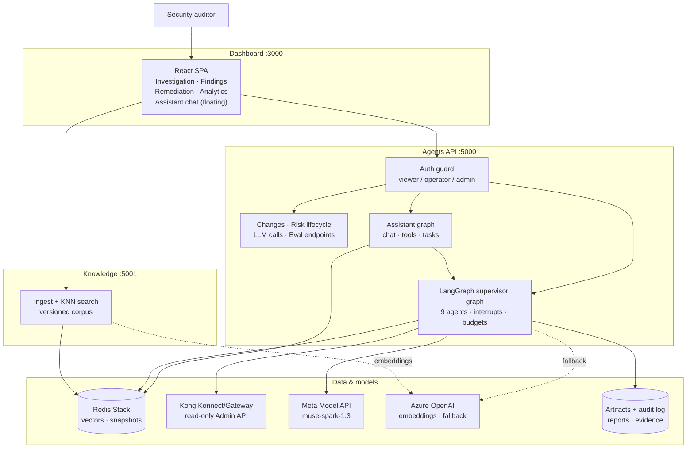

# Final Architecture

System-level view of the Enterprise API Security Auditor as shipped for
the hackathon. The multi-agent workflow detail lives in
[multi-agent-architecture.md](multi-agent-architecture.md).

## The 13-step journey, mapped to code

| Step | What happens | Where |
|---|---|---|
| 1. Start | `POST /assess` (sync or `?async=true`), validated payload | `agents/init_auditor.py` |
| 2. Auth | API key → role; viewer/operator/admin route matrix | `common/auth.py` |
| 3. Plan | Supervisor builds investigation plan + stopping criteria | `agents/orchestrator.py` supervisor |
| 4. Discover | Kong inventory, live → Redis snapshot → file, with provenance | `common/kong_inventory.py` |
| 5. Investigate | Security / compliance / threat agents run in parallel, fan-in | orchestrator investigators + aggregate |
| 6. Correlate | Deduplicated, versioned-scored risk register | `common/risks.py` |
| 7. Reason | Muse Spark 1.3 via central router (9 reasoning tasks: 6 investigation + 3 assistant) | `common/router.py`, `common/llm.py` |
| 8. Propose | Structured change proposals + simulation + residual risk | `common/changes.py` |
| 9. Validate | Plan checks before approval is requested | orchestrator validation |
| 10. Approve | Human interrupt; unknown answers resolve to reject | orchestrator governance |
| 11. Execute | Allowlisted adapter; approval + scope + flag gates | `common/kong_adapter.py` |
| 12. Confirm | Plugin readback recorded as post-change validation | `kong_adapter._post_validate` |
| 13. Report | Summary, inventory snapshot, call log, hash-chained audit log | finalize + `common/audit_log.py` |

## Trust boundaries

- Everything outside the `common/` deterministic core is untrusted input:
  Kong names/paths are flattened before prompts, retrieved text is
  delimited and never obeyed, model output is parsed strictly and
  verified against inventory.
- The model proposes; code disposes. Scoring, verification, budgets,
  approvals and execution gates all run outside the LLM.
- Writes are impossible by default: live Kong execution needs a recorded
  approval, in-scope target, allowlisted op, and `KONG_WRITE_ENABLED=true`.
- The chat assistant holds a read + draft-only tool allowlist: no
  approve, execute or persist tool exists for it, so chat can never
  change anything regardless of what it is asked.
