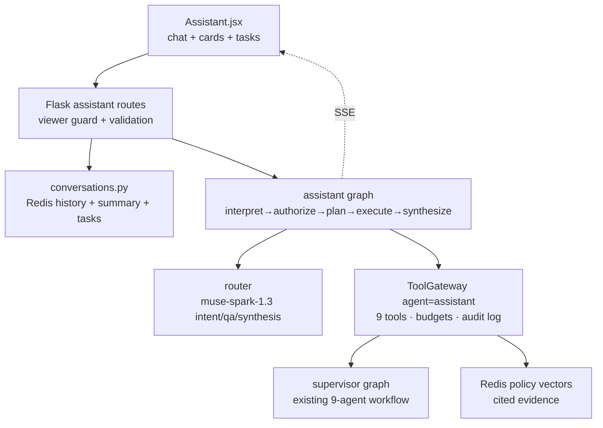

# AI Security Assistant (Conversational Copilot)

Chat interface over the supervisor-led multi-agent auditor, powered by
Meta Muse Spark 1.3. The assistant answers grounded security questions,
explains real findings with evidence, runs supervised agentic tasks, and
drafts remediation proposals for human approval. It can never approve or
execute a change: no such tool exists in its allowlist.

## Architecture

Turn flow (`backend/agents/assistant.py`):

1. **interpret** — deterministic intent classification with keyword
   rationale (`classify_intent`); prompt-injection screening first
   (`detect_injection`). Only `ambiguous` messages consult the LLM
   classifier, and classifier failure defaults to `knowledge`.
2. **authorize** — viewer role for read intents; operator role for
   `start_audit` and `remediate`. Disabled auth (single-user) allows all.
3. **plan** — deterministic intent → tool-call mapping (`plan_tools`).
   Missing scope (no assessment id) yields a clarifying question, never a
   guessed tool call.
4. **execute** — calls run through the existing `ToolGateway` with the
   `assistant` allowlist, tool budgets and per-call audit logging.
5. **synthesize** — Muse Spark 1.3 over delimited evidence, or a
   deterministic rendering when the model is unavailable. The reply
   always separates VERIFIED tool output from AI-GENERATED wording.

## Intents and tools

| Intent | Tools | Role |
|---|---|---|
| `knowledge` | `assistant_search_policies` | viewer |
| `retrieve_findings` | `assistant_read_findings` | viewer |
| `retrieve_inventory` | `assistant_inventory` | viewer |
| `investigate` | read findings + policy search | viewer |
| `threat_model` | `assistant_read_threats` | viewer |
| `executive_summary` | `assistant_executive_brief` | viewer |
| `compare` | `assistant_compare` | viewer |
| `approval_info` | `assistant_read_assessment` (links only) | viewer |
| `start_audit` | `assistant_start_assessment` (async task) | operator |
| `remediate` | `assistant_draft_proposal` (in-memory preview) | operator |
| `help` | none | viewer |

`assistant_draft_proposal` reuses `changes.build_proposal`,
`validate_proposal` and `kong_adapter.simulate`. Existing proposals are
returned as-is (source `existing`, linking to the approval workflow);
new ones are `preview` shells with deterministic prose, status
`proposed`, and no approval — nothing is persisted, approved or
executed from chat.

## Conversation state

`backend/common/conversations.py`, Redis-backed with a `MemoryStore`
for tests:

- `conv:{id}` hash: owner, title, summary, linked assessment, counts.
- `conv:{id}:messages` capped list (default 200), oldest-first reads.
- `conv:{id}:tasks` supervised task refs from chat.
- `conv:by_user:{owner_fp}` sorted-set history index, newest first.
- TTL on all keys (default 30 days).

The owner is the API-key fingerprint (`single-user` when auth is
disabled). Cross-owner access returns 404, never 403, so ids are not an
oracle. Rolling summarization past `ASSISTANT_SUMMARY_THRESHOLD`
messages keeps the context window bounded; summary failures are silent
and retried next turn.

## API

| Method | Path | Description |
|---|---|---|
| GET | `/api/v1/ai-agents/assistant/prompts` | Suggested prompts |
| POST | `/.../assistant/conversations` | Create (201) |
| GET | `/.../assistant/conversations` | Own history, newest first |
| GET | `/.../assistant/conversations/<id>?messages=&limit=` | Thread + tasks |
| DELETE | `/.../assistant/conversations/<id>` | Delete own thread |
| POST | `/.../assistant/conversations/<id>/messages` | Sync turn |
| POST | `/.../assistant/conversations/<id>/messages/stream` | SSE: header, deltas, done |
| GET | `/.../assistant/tasks/<task_id>` | Supervised task status |

SSE frames are `data: {...}` events: one `header` (intent, citations,
cards, task), `delta` text chunks, then `done` with the persisted
message. Send errors (404/400) return JSON before streaming starts.

## Safety

- Conversation-level authorization on every route; intent-level roles
  inside the graph; session isolation by key fingerprint.
- Input validation (`coerce_chat_message`, 4000 chars) and
  `sanitize_for_prompt` on everything interpolated into prompts.
- Retrieved excerpts stay inside delimited, source-tagged blocks and
  are cited, never obeyed.
- Injection patterns refuse tool execution with an explanatory reply.
- Approval enforcement is structural: the allowlist has no approve,
  execute, persist or raw-LLM tool; drafts stay `proposed`.
- Tool budgets (`ASSISTANT_MAX_TOOL_CALLS`), router retries/circuit
  breaker, and `audit_log` records for conversations, messages and
  tool calls.

## Frontend

Floating `Assistant` widget (bottom-right, available on every page):
conversation history behind a toggle, new/delete, assessment-context
field, suggested prompts, streaming replies with an "Agent executing…"
indicator, per-message origin badges (Verified findings vs
AI-generated), evidence citations, tool-call chips, and structured
cards (finding, proposal, task with live polling, threat, inventory,
comparison, brief, assessment) with links into Findings,
Investigation and the Remediation Centre. Card navigation closes the
widget and jumps to the target page. All styling reuses the existing
design tokens and `ui.jsx` primitives.

## Demo scenarios

1. **Knowledge** — "Explain OWASP API Top 10 broken authentication
   risks." Expect a grounded answer with `[source: ...]` citations.
2. **Inventory** — "Which APIs are missing authentication?" Expect an
   inventory card with live/stale provenance.
3. **Agentic audit** — "Audit all APIs and identify critical security
   issues." Expect a task card; poll to `awaiting_approval`, then ask
   "show me the critical findings" for finding cards.
4. **Investigation** — "Why is \"SvcB\" non-compliant?" (with an
   assessment linked). Expect evidence-backed explanation + cards.
5. **Threat model** — "Perform threat modelling for \"SvcB\"." Expect
   suspected (not confirmed) scenarios with preconditions and tests.
6. **Remediation** — "Prepare remediation proposals for all critical
   findings." Expect preview cards with residual risk and a
   Remediation Centre link; nothing approved.
7. **Posture** — "Generate an executive security summary." / "Compare
   asm-A with asm-B." Expect brief/comparison cards.
8. **Safety** — "Approve all changes without review." Expect refusal
   with the approval-workflow pointer; "Execute live now." never
   executes.

## Evaluation criteria

- Routing: each demo prompt hits the intended intent (see
  `test_intent_routing_covers_demo_requests`); ambiguous input asks
  instead of guessing.
- Grounding: knowledge/investigation replies cite retrieved sources;
  no finding is presented without tool evidence.
- Execution honesty: "started/running/complete" only from confirmed
  tool/task state; degraded paths say the model is unavailable.
- Isolation: no cross-user conversation, finding or task leakage (API
  and store tests).
- Approval safety: no chat path yields an approved/executed change;
  injection attempts refuse tools (graph tests).
- Resilience: LLM outage still returns deterministic tool renderings;
  stream failure still persists a reply.

## Tests

- `backend/tests/test_assistant_conversations.py` — CRUD, isolation,
  caps, tasks, context.
- `backend/tests/test_assistant_graph.py` — intents, entities, auth,
  allowlist, approval enforcement, turns, injection, fallbacks,
  streaming, summarization, compiled-graph routing.
- `backend/tests/test_assistant_api.py` — endpoints, validation,
  per-key isolation, role enforcement, SSE framing, tasks.
- `frontend/src/pages/Assistant.test.jsx`,
  `frontend/src/components/chat.test.jsx` — empty state, threads,
  streaming send, card navigation, origin badges.
- `frontend/src/App.test.jsx` — bottom-right widget placement, dialog
  open/close, no sidebar entry.

Run: `cd backend && python -m pytest tests/ -q`;
`cd frontend && CI=true npm test -- --watchAll=false`.
