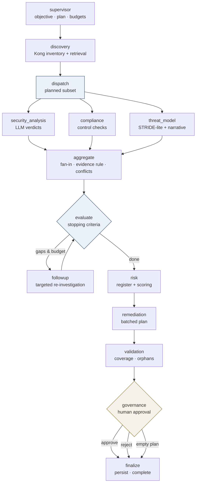

# Multi-Agent Assessment Workflow

Supervisor-led LangGraph orchestration for the Enterprise API Security Auditor.
This extends the existing single-agent pipelines (`audit_app`, `rem_app`) — those
endpoints keep working unchanged. The workflow below adds parallel investigation,
evidence enforcement, risk scoring, validation and a human approval gate.

## Workflow

## Agent contracts

| Agent | Responsibility | Input | Output | Permitted tools |
|---|---|---|---|---|
| supervisor | Plan assessment, own ids/budgets/status, conditional routing | standards, services?, top_k? | ids, budgets, routes | none |
| discovery | Resilient Kong inventory (live→snapshot→file) + retrieval (see `kong-integration.md`) | service_names?, top_k | kong_data, provenance (live/stale/gaps/caps/changes), policy_context | kong_inventory, kong_snapshot_*, kong_fallback, vector_search |
| security_analysis | LLM verdicts per service (Muse Spark) | kong_data, policy_context, scope | findings[] with evidence_ids | llm_audit_verdict |
| compliance | Deterministic controls + versioned policy catalog | kong_data, policy_context | controls[], control_results[], policy_findings[], coverage | none |
| threat_model | OWASP scenarios from route evidence + path elaboration | kong_data, priority_services, scope | threats[] (structured hypotheses) | llm_threat_elaborate |
| risk | Deduplicated register + versioned scoring (see `risk-register.md`) | findings, policy findings, inventory, controls | risk {register, summary, by_level, explanation} | llm_risk_explain |
| remediation | Batched fix plan + structured change proposals (see `controlled-remediation.md`) | findings, risk, excerpts, kong_data | remediation_plan[], excluded[], change_proposals[] | llm_remediation_batch, llm_change_prose_batch |
| validation | Coverage/orphan/re-verification checks | findings, plan, context | validation {passed, checks} | verify_finding |
| governance | Human approval gate (interrupt; export only, never executes) | plan, risk, validation | approval {decision, reviewer} | persist_artifact |

Supervisor sub-routines: `dispatch` (finalize the investigator subset),
`followup` (`vector_search` + `llm_correlate`, bounded by max rounds),
`evaluate` (record the stopping assessment), `finalize` (`persist_artifact`).

## Key behaviors

- **Plan-investigate-evaluate-decide**: the supervisor drafts a plan from the
  assessment objective (focus areas, investigator subset, depth budgets, all
  with rationale), `dispatch` finalizes it against the discovered inventory,
  `evaluate` re-assesses gaps versus stopping criteria after every round.
- **Conditional fan-out**: only planned investigators run; an empty inventory
  skips them entirely. Shared state uses reducers (append lists, merge dicts,
  max-merge budgets) so parallel writes never clash.
- **Evidence rule**: a security finding without retrieved policy evidence is
  quarantined with an explicit reason — never planned against, never silently
  dropped. Inventory facts (plugin absent) stay in discovery output; only
  *verdicts* require evidence.
- **Finding tiers**: confirmed (grounded verdict + independent control gap),
  suspected (grounded indicator, needs review), informational (compliant),
  unverified (all else). Confirmed still means configuration gap, never a
  proven-exploitable vulnerability. Remediation takes confirmed/suspected at or
  above the plan's minimum confidence only.
- **Stopping criteria**: hard stops on max rounds, model calls, tool calls and
  duration; soft gaps (open conflicts, quarantine, thin evidence) continue the
  loop while budget remains. Every routing decision is recorded with reasons.
- **Depth presets**: quick (1 round, tight budgets), standard, deep.
- **Risk register**: findings deduplicate by (service, topic), correlate by
  capability, link to controls, and score under model v1.0.0 (weighted
  factors × confidence blend; see `risk-register.md`). Entries carry a
  lifecycle (open/accepted/mitigated/remediated) managed via the transition
  endpoint; Muse explains the ranking only.
- **Budgets**: model and tool calls are locked-counted; exhaustion raises
  instead of silently proceeding. Totals reconcile from per-agent tool records
  so checkpoint resume never loses counts.
- **Timeouts/retries**: every agent runs with a wall-clock timeout (default 180s)
  and retry limit (default 1); exhaustion marks the agent failed and the run
  continues degraded. Governance runs unthreaded (interrupts need the graph
  thread) and waits for the human without timeout.
- **Checkpointing/resume**: `MemorySaver` keyed by `assessment-{id}`; resume with
  `Command(resume={...})`. In-process by design; a Redis-backed checkpointer is
  future work and needs no workflow changes.
- **Traceability**: stable `assessment_id` across resume, per-agent records with
  inputs/outputs/decisions/model/tool calls/timings, plus an append-only trace.

## API

| Method | Path | Description |
|---|---|---|
| POST | `/api/v1/ai-agents/assess` | Start assessment; 202 + `approval_request` at the gate (`?async=true` returns immediately for live polling) |
| GET | `/api/v1/ai-agents/assess/<id>` | Snapshot: status, agents, budgets, risk register, pending approval |
| POST | `/api/v1/ai-agents/assess/<id>/resume` | Answer the gate (`approve`/`reject`, reviewer?, note?) |
| POST | `/api/v1/ai-agents/assess/<id>/executive-summary` | On-demand risk + board summary (completed runs) |
| POST | `/api/v1/ai-agents/assess/<id>/risk/<entry>/transition` | Move a register entry through its lifecycle |
| GET | `/api/v1/ai-agents/assess/<id>/changes` | Change proposals with simulation + residual risk |
| POST | `/api/v1/ai-agents/assess/<id>/changes/<change>/approve` | Record human approval (reviewer required) |
| POST | `/api/v1/ai-agents/assess/<id>/changes/<change>/execute` | Simulate (default) or live-execute (approved + flag) |
| GET | `/api/v1/ai-agents/assess` | Recent-run index for the dashboard |
| GET | `/api/v1/ai-agents/assess/<id>/details` | Full execution snapshot (agents, plan, trace) |
| GET | `/api/v1/ai-agents/llm/policy` | Enforced model-routing table |
| GET | `/api/v1/ai-agents/eval/retrieval?store=` | Retrieval hit@k / MRR on demand |
| GET | `/api/v1/ai-agents/llm/calls` | Router call log: model, task, latency, usage, fallbacks |

Approval authorises plan **export** only. The workflow never writes to Kong.

## Tests

`backend/tests/test_orchestrator.py` covers: gateway allowlists/budgets, full
workflow success, parallel execution (timestamp overlap), agent failure
containment, missing-evidence quarantine, conflict detection and exclusion,
retry exhaustion, timeouts, bounded followup, recovery, checkpoint resume,
approval interrupt (approve/reject/skip), and the HTTP endpoints.
